# NACA 2412 Airfoil CFD Simulation – AoA 4°

## 1. Project Overview

This project investigates the aerodynamic performance of a NACA 2412 airfoil using ANSYS Fluent.

A two-dimensional external aerodynamic simulation was performed at a Mach number of 0.6 and an angle of attack of 4°.

The objective is to examine the flow field, pressure distribution, velocity distribution, turbulence characteristics, and aerodynamic force convergence.

## 2. Simulation Setup

| Parameter | Configuration |
|---|---|
| Airfoil | NACA 2412 |
| Simulation type | 2D External Flow |
| Solver | Pressure-Based |
| Time | Steady |
| Velocity formulation | Absolute |
| Mach number | 0.6 |
| Angle of attack | 4° |
| Turbulence model | k-ω SST |
| Energy equation | Enabled |
| Working fluid | Air |

## 3. Boundary Conditions

- Inlet: Velocity inlet.
- Upper and lower boundaries: Pressure far-field.
- Outlet: Pressure outlet.
- Airfoil surface: Stationary, no-slip wall.
- Far-field gauge pressure: 0 Pa.
- Turbulence intensity: 5%.
- Turbulent viscosity ratio: 10.

## 4. Mesh Independence Study

A mesh refinement study was conducted to investigate the sensitivity of aerodynamic coefficients to mesh resolution.

| Mesh | Number of Elements | CL | CD |
|---|---:|---:|---:|
| Coarse | 28,300 | 0.72 | 0.0188 |
| Medium | 43,572 | 0.72 | 0.0180 |
| Fine | 240,998 | 0.74 | 0.0160 |

The results indicate changes in the predicted lift and drag coefficients with mesh refinement. Further assessment of mesh independence is required before establishing the final mesh.

## 5. Figures and Results

### Computational Domain
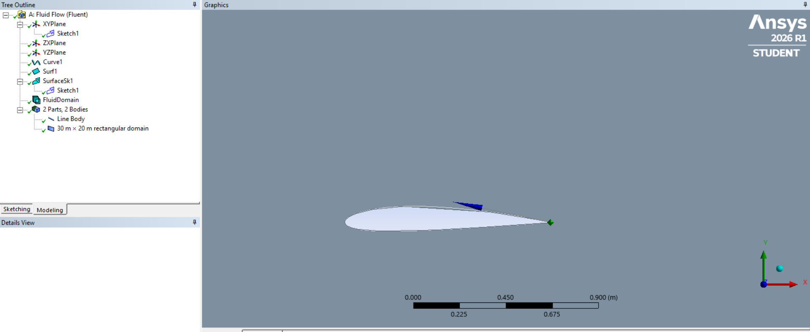

### Computational Mesh
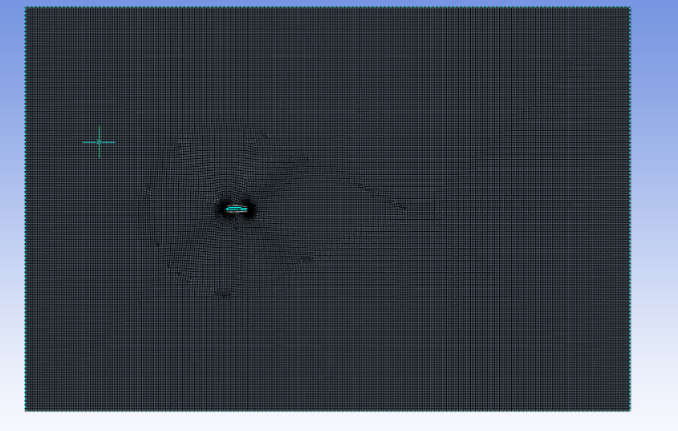

### Mesh Refinement
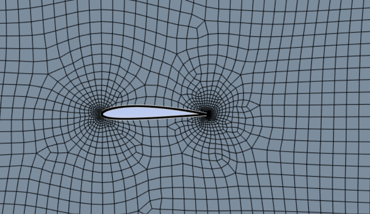

### Mesh Statistics
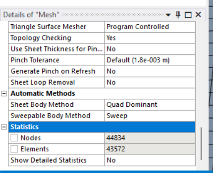

### Velocity Contour
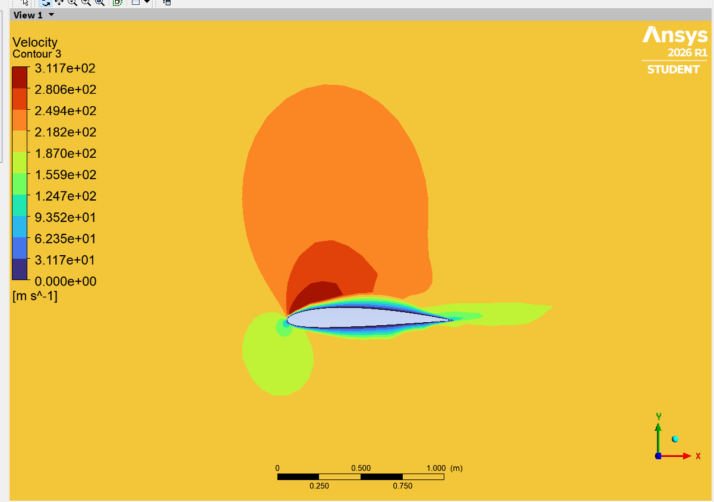

### Pressure Contour
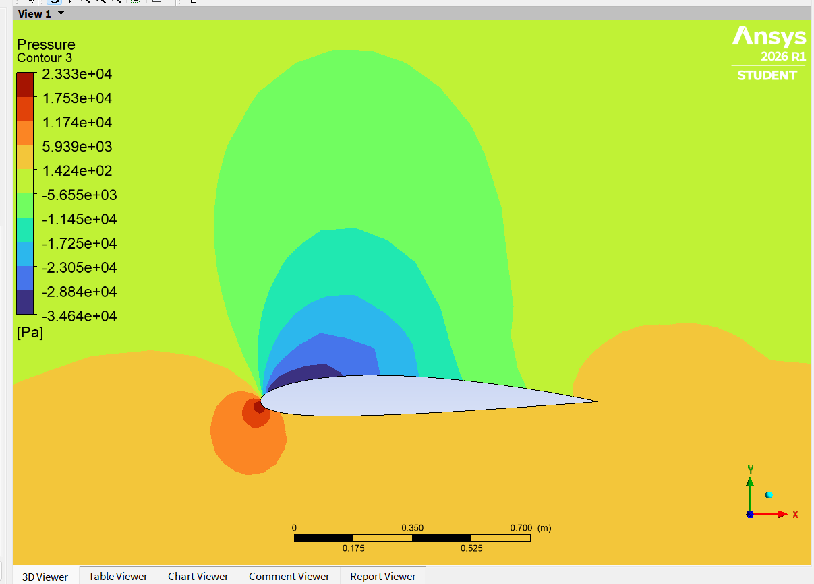

### Turbulent Kinetic Energy
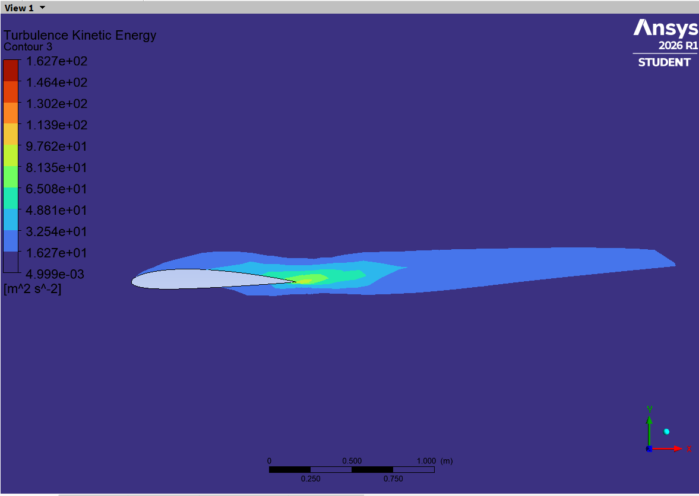

### Velocity Streamlines
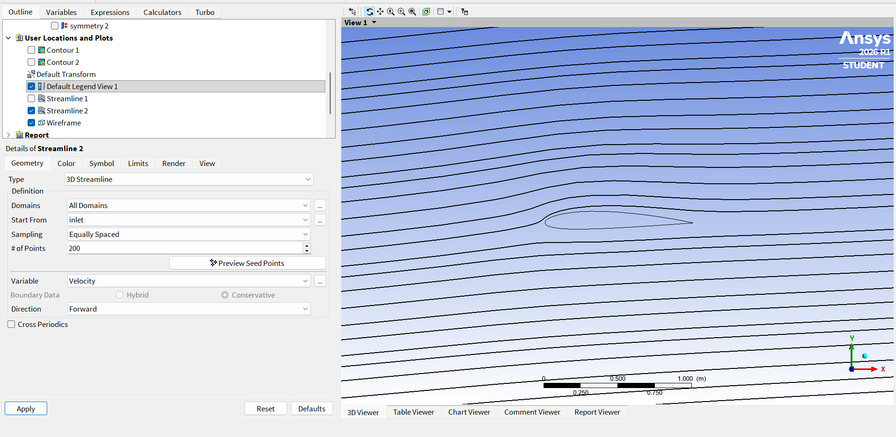

### Residual Convergence
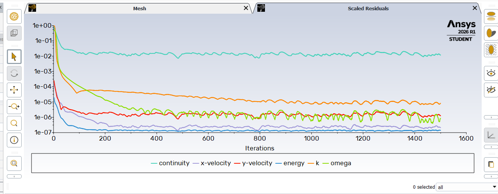

### Lift Coefficient Convergence
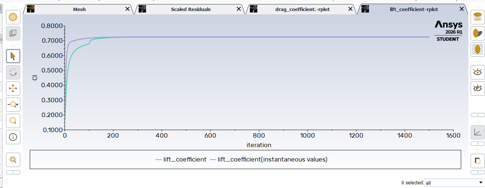

### Drag Coefficient Convergence
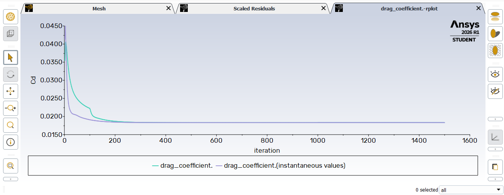

## 6. Software

- ANSYS Fluent 2026 R1
- ANSYS Meshing

## 7. Project Status

The 4° angle-of-attack simulation and associated post-processing figures have been uploaded.

Further work includes mesh-independence verification and comparison of aerodynamic coefficients across different angles of attack.
